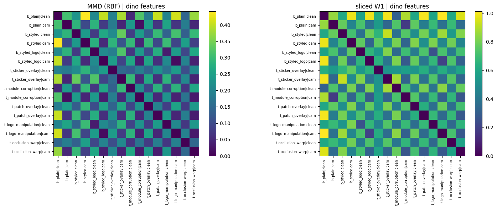
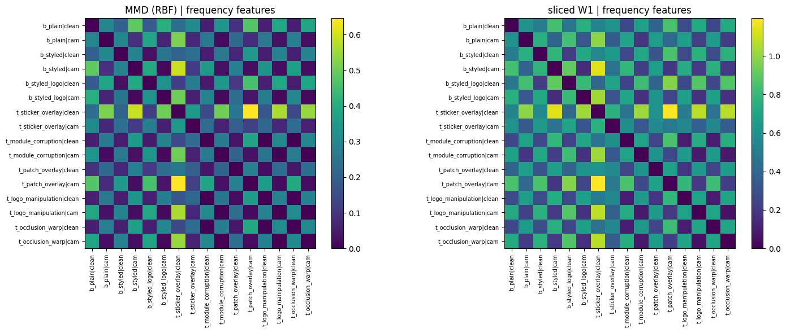

# QRShield v2 — Study 5: Frequency Priors, Foundation Features and Robustness

> Companion study to notebooks 1–3 of QRShield v2 (QR-code tamper detection).
> Notebook: `5_Frequency_Priors_and_Robustness_Study.ipynb`

---

## Abstract

We ask whether ideas from recent frequency-prior and frequency–spatial-fusion papers (HFP-SAM, SFMFusion, ISFM; Prof. Pingping Zhang's group, Dalian University of Technology) help detect tampered QR codes. Using cached features and saved models from notebooks 1–3, we run six small, CPU-friendly experiments (RQ1–RQ6) on a 66,083-image synthetic dataset with five tamper families and a camera-simulation layer.

The main findings are mostly **negative or modest**:

1. A **local** wavelet prior (top-k high-frequency windows) does **not** beat the **global** FFT features (mean AUROC 0.748 vs 0.819). It wins on only one family (`patch_overlay`), and only in its multi-scale form.
2. Frequency-based window selection does not help: 10 *random* windows (0.770) beat the top-10 *frequency-selected* windows (0.748). Canny edges are the weakest cue (0.683).
3. Under noise, hand-crafted wavelet features collapse (AUROC 0.778 → 0.513 at Gaussian σ = 0.20), while DINOv2 (0.958 → 0.897) and EfficientNet (0.971 → 0.944) degrade gracefully.
4. Frequency-guided gated fusion of DINOv2 + frequency cues gives a **small** gain over DINOv2 alone on unseen families (LOFO 0.851 vs 0.837) and is statistically indistinguishable from plain concatenation (0.846).
5. Transfer is fragile. A DINOv2 classifier trained on clean images only drops to 0.561 AUROC on camera images, and one trained without styled/logo benign codes flags 96.1 % of them as tampered.

> **None of the results here should be described as reproducing the original papers.** See [Deviations](#6-deviations-from-the-source-papers).

---

## 1. Research questions

| # | Source in the papers | Question |
|---|---|---|
| **RQ1** | HFP-SAM §III-A/B: Haar-wavelet high-frequency map, sliding windows, top-k selection | Does a *local* wavelet prior detect local tampering better than the *global* FFT spectrum (notebooks 1–2), especially on `module_corruption`? |
| **RQ2** | HFP-SAM Tables IV/V (window size, number of windows, random vs global vs frequency-selected) and §F (wavelet vs Canny) | Does frequency-based window selection matter? Wavelet vs Canny? Sensitivity to window size and k? |
| **RQ3** | HFP-SAM §E (Gaussian and speckle noise) | How do wavelet, FFT, DINOv2 and EfficientNet cues degrade under noise? |
| **RQ4** | HFP-SAM Fig. 5 (Wasserstein-1 and MMD-RBF between datasets) | How large are the distribution shifts between benign styles, the camera layer and tamper families? Does shift predict transfer failure? |
| **RQ5** | SFMFusion / ISFM introductions | Does frequency-*guided* gated fusion of DINOv2 + frequency cues beat plain concatenation, especially on unseen families (LOFO)? |
| **RQ6** | HFP-SAM §I (zero-shot / cross-domain evaluation) | Do features transfer from clean → camera images, and from plain benign → styled/logo benign codes? |

**What was actually read.** HFP-SAM (arXiv 2603.12708) was read in full. For SFMFusion (arXiv 2511.06593) and ISFM (arXiv 2602.04405) only abstracts and introductions were read, so RQ5 is a *simplified analogue* of the interaction idea, not a reimplementation.

---

## 2. Data and protocol

| Item | Value |
|---|---|
| Total images | 66,083 (24 shards) |
| Main set | 60,000 — train 41,958 / val 5,810 / test 12,232 |
| Camera benchmark | 6,083 (built from test base codes only) |
| Tamper families | `sticker_overlay`, `module_corruption`, `patch_overlay`, `logo_manipulation`, `occlusion_warp` |
| Benign classes | `benign_plain`, `benign_styled`, `benign_styled_logo` |
| Input size | 224 × 224 |
| Camera-layer share | ≈ 0.40 for both benign and tampered (asserted in code) |
| Seeds | 0, 1, 2 |

**Integrity checks (asserted in the notebook):** group split by base QR code (no base code appears in two splits); camera benchmark never shares a base code with train/val; all image files exist; feature rows match the manifest; the PIL-based FFT function reproduces the stored notebook-1 features (`atol = 1e-3`).

**Evaluation.**
* Metric: AUROC (threshold-free); accuracy, balanced accuracy and F1 are also stored. The decision threshold is picked on validation to maximise balanced accuracy.
* Per-family scores use all of that family's images plus an equally sized, fixed-seed subsample of benign images (removes class-imbalance effects).
* **Final** = all families seen in training. **LOFO** = leave-one-family-out: the evaluated family is absent from training and validation.
* ± values are the standard deviation over 3 classifier seeds. Features and splits are fixed, so this captures classifier/training randomness only.

---

## 3. Feature sets and models

| Name | Dim | Description |
|---|---|---|
| `fft_global` | 81 | Global FFT features from notebook 1 (radial profile, angular energy, high-frequency power ratio) |
| `wav_topk` | 17 | HFP-SAM style: Haar DWT → mean of the three high-frequency sub-band magnitudes → 8 × 8 windows → top-10 window responses + 3 stats + 4 global stats |
| `wav_multi` | 73 | Same, three window sizes (4 / 8 / 16 on the 112 × 112 map), k = 20 |
| `wav_random` | 14 | 10 randomly chosen (fixed-seed) window positions — no frequency selection |
| `wav_global` | 7 | Statistics over all windows — no selection |
| `canny_topk` | 14 | Canny edge density in 16-px windows, top-10 + global density |
| `dino_ref` | 768 | Frozen DINOv2-small tokens (`cls+mean` set, from notebook 2's config) |
| `abl_ws4/ws16`, `abl_k5/k20` | 17–27 | Window-size / k sensitivity variants of `wav_topk` |

**Classifiers.** Hand-crafted features → `HistGradientBoostingClassifier` (300 iterations, lr 0.1, early stopping). `dino_ref` → standardised, 1-hidden-layer MLP (256 units). Identical classifier and protocol for every feature set within a comparison.

**RQ5 fusion models** (small Keras networks on frozen features; 12 epochs, best-val-AUC weights restored):

| Mode | Description |
|---|---|
| `fus_dino` | DINOv2 branch only |
| `fus_freq` | Frequency branch only (81 FFT + 269 wavelet + 70 Canny = 420-d) |
| `fus_concat` | Serial/parallel fusion: concatenate both, then dense layer |
| `fus_gated` | Frequency branch → sigmoid gate that multiplies the DINOv2 hidden layer ("frequency guides spatial") |

---

## 4. Results

### RQ1 — Local wavelet prior vs. global FFT

Mean AUROC, in-distribution test, all families seen (final model):

| Features | sticker | module_corr. | patch | logo | occlusion | **Average** |
|---|---|---|---|---|---|---|
| `fft_global` | 0.957 | 0.601 | 0.890 | 0.819 | 0.829 | **0.819** |
| `wav_topk` | 0.891 | 0.573 | 0.854 | 0.670 | 0.754 | **0.748** |
| `wav_multi` | 0.913 | 0.601 | 0.929 | 0.711 | 0.773 | **0.786** |
| `dino_ref` | 0.998 | 0.863 | 0.999 | 0.961 | 0.978 | **0.960** |

Unseen-family AUROC (LOFO), averages: `fft_global` 0.766, `wav_topk` 0.701, `wav_multi` 0.742, `dino_ref` 0.840.

**Reading.** The answer to RQ1 is **no**. Local top-k wavelet windows are worse than the global FFT on average and on 4 of 5 families. The only win is `wav_multi` on `patch_overlay` (0.929 vs 0.890 seen; 0.900 vs 0.847 unseen). On `module_corruption` — the family the local prior was expected to help most — no hand-crafted frequency feature exceeds ~0.60 AUROC, whereas frozen DINOv2 reaches 0.863 (seen) / 0.634 (unseen).

### RQ2 — Does frequency-based window selection matter?

| Variant (final, avg AUROC) | |
|---|---|
| `wav_topk` (frequency-selected, k = 10) | 0.748 |
| `wav_random` (10 random windows) | **0.770** |
| `wav_global` (all-window statistics) | 0.749 |
| `canny_topk` | 0.683 |

Sensitivity (final model):

| Window size (k = 10) | 4 → **0.741** · 8 → **0.748** · 16 → **0.765** |
|---|---|
| **k (window = 8)** | 5 → **0.749** · 10 → **0.748** · 20 → **0.747** |

**Reading.** Frequency-selected windows are no better than random or all-window statistics, so the "frequency prior selects informative regions" mechanism is not supported in this setting. Larger windows help slightly; k has essentially no effect. Wavelet clearly beats Canny.

*Possible (untested) explanation:* `wav_random` keeps the *spatial position* of each window, whereas top-k sorts responses and discards position. In QR codes, position is informative (finder patterns, quiet zone). This was not tested.

### RQ3 — Noise stress test

Classifiers trained on clean images only; AUROC on 6,000 test images per condition (half benign / half tampered). Noise scale is on a 0–1 pixel range (our choice).

| Noise | σ | `fft_global` | `wav_multi` | `canny_topk` | `dino_ref` | `effnet_v2` |
|---|---|---|---|---|---|---|
| clean | 0 | 0.814 | 0.778 | 0.673 | 0.958 | 0.971 |
| Gaussian | 0.05 | 0.799 | 0.610 | 0.666 | 0.942 | 0.968 |
| Gaussian | 0.10 | 0.776 | 0.540 | 0.637 | 0.931 | 0.964 |
| Gaussian | 0.20 | 0.708 | 0.513 | 0.507 | 0.897 | 0.944 |
| Speckle | 0.05 | 0.808 | 0.624 | 0.670 | 0.945 | 0.970 |
| Speckle | 0.10 | 0.789 | 0.600 | 0.644 | 0.941 | 0.967 |
| Speckle | 0.20 | 0.759 | 0.528 | 0.548 | 0.922 | 0.957 |

**Reading.** The wavelet high-frequency map is the *least* noise-robust cue: it loses ~0.17 AUROC already at σ = 0.05 and is near chance at σ = 0.20 — noise lives in exactly the sub-bands it relies on. Global FFT is more stable; the learned features (DINOv2, EfficientNet) are the most robust.

### RQ4 — Distribution shift

Pairwise unbiased RBF-MMD² (median heuristic) and sliced Wasserstein-1 (64 projections) between groups defined by *QR class × (clean / camera)*, 1,000 train images per group, in standardised DINOv2 space and in frequency space. Full matrices and heatmaps are saved to `study5_tables/` (see [Outputs](#8-outputs)).

**DINOv2 feature space** (left: MMD, right: sliced W1):



**Frequency feature space** (FFT + wavelet):



Key numbers (DINOv2 space):

| Pair | MMD² |
|---|---|
| plain benign vs. styled benign | 0.2283 |
| plain benign clean vs. plain benign camera | 0.3099 |

**Reading.** The camera layer shifts the feature distribution more than benign styling does. However, RQ6 shows that shift magnitude alone does **not** predict transfer failure (see below). RQ4 distances are descriptive and do not establish causation.

### RQ5 — Frequency-guided fusion

AUROC averaged over the five families.

| Model | Seen (final) | Unseen (LOFO) |
|---|---|---|
| `fus_dino` | 0.962 ± 0.000 | 0.837 ± 0.006 |
| `fus_freq` | 0.874 ± 0.004 | — |
| `fus_concat` | 0.966 ± 0.001 | 0.846 ± 0.002 |
| `fus_gated` | 0.966 ± 0.001 | **0.851 ± 0.006** |

Per family, LOFO (DINO → concat → gated): `sticker_overlay` 0.897 → 0.930 → 0.932; `logo_manipulation` 0.773 → 0.794 → 0.801; `module_corruption` 0.626 → 0.632 → 0.641; `occlusion_warp` 0.891 → 0.876 → 0.881 (fusion is *worse*).

**Reading.** Adding frequency cues to DINOv2 helps a little on unseen families (+0.009 to +0.014 average AUROC), concentrated in `sticker_overlay` and `logo_manipulation`. Gated vs. concat differs by 0.005, which is within about one standard deviation, so **no claim of superiority for gating is supported**. Frequency cues alone are clearly weaker (0.874).

### RQ6 — Cross-domain transfer

AUROC (mean over 3 seeds; ± omitted here, all ≤ 0.02 except where noted in `rq6_transfer.csv`).

| Features | Trained on | Clean test | Camera test | Styled-benign vs tamper | FPR on styled/logo benign |
|---|---|---|---|---|---|
| `dino_ref` | all | 0.972 | 0.940 | 0.962 | 0.038 |
| `dino_ref` | clean only | 0.971 | **0.561** | 0.778 | 0.381 |
| `dino_ref` | camera only | 0.948 | 0.940 | 0.947 | 0.059 |
| `dino_ref` | no styled benign | 0.669 | 0.689 | **0.475** | **0.961** |
| `fft_global` | all | 0.852 | 0.754 | 0.806 | 0.184 |
| `fft_global` | clean only | 0.858 | 0.626 | 0.701 | 0.451 |
| `fft_global` | no styled benign | 0.585 | 0.614 | 0.382 | 0.921 |
| `wav_multi` | all | 0.838 | 0.677 | 0.764 | 0.207 |
| `wav_multi` | clean only | 0.845 | 0.542 | 0.702 | 0.388 |
| `wav_multi` | no styled benign | 0.612 | 0.590 | 0.413 | 0.851 |

**Reading.**
* **Clean → camera transfer fails** for every feature set (DINOv2: 0.971 → 0.561 on camera images). **Camera → clean** transfer is much better for DINOv2 (0.948) than for hand-crafted features (FFT 0.774, wavelet 0.663) — the transfer is asymmetric.
* **Unseen benign styles are the worst failure.** Without styled/logo benign codes in training, all classifiers label most of them as tampered (FPR 0.85–0.96) and AUROC on styled-benign vs tamper falls *below chance* (0.38–0.48).
* Combined with RQ4: the benign-style shift is *smaller* in MMD (0.228) than the camera shift (0.310), yet causes the *larger* failure. Distance in feature space is therefore a poor predictor of transfer failure here. This is based on a single pair of distances and should be treated as an observation, not a conclusion.

---

## 5. Summary of conclusions

| RQ | Answer |
|---|---|
| RQ1 | Local wavelet top-k windows do **not** beat global FFT overall; they win only on `patch_overlay` (multi-scale). |
| RQ2 | Frequency-based window selection does **not** help (random ≥ selected). Window size matters slightly (larger is better), k does not. Wavelet > Canny. |
| RQ3 | Wavelet features are the most noise-fragile; DINOv2 and EfficientNet are robust. |
| RQ4 | Camera shift > benign-style shift in DINOv2 MMD, but shift size does not predict failure. |
| RQ5 | Gated fusion gives a small, non-significant improvement over concat; both slightly improve on DINOv2 alone for unseen families. |
| RQ6 | Clean → camera and unseen benign styles both break transfer; unseen benign styles are worse. Training data must cover benign styling and the camera layer. |

---

## 6. Deviations from the source papers

* Windows are **non-overlapping** (the papers use sliding windows).
* The high-frequency map averages the **magnitudes** of the three sub-bands (signed averaging cancels).
* The classifier is gradient boosting / a small network on **frozen features**, not an end-to-end segmentation model.
* Distances use an unbiased RBF-MMD with the median heuristic and a **sliced** Wasserstein-1.
* RQ5 is a simplified gated analogue of the interaction idea, based on abstracts and introductions only.
* The papers' noise pixel scale is unstated; we use σ ∈ {0.05, 0.10, 0.20} on a 0–1 scale.

## 7. Limitations

* All images are **synthetic**; there is no real-camera test set. Camera effects are simulated.
* Inputs are 224 × 224 only.
* Hand-crafted-feature noise tests use a single classifier seed (seed 0).
* The ± values reflect classifier randomness only; splits and features are fixed, so uncertainty from data sampling is not captured.
* `fus_gated` and `fus_concat` are not capacity-matched.
* RQ4 is descriptive and shows no causal link between shift and failure.
* The explanation for why random windows beat selected windows (positional information) is a hypothesis and was not tested.

---

## 8. Reproducing

**Run order.** Notebooks 1 and 2 first (this notebook needs the cached `freq` and `dino_small` features, and uses `dino_config.json` from notebook 2 if present). Notebook 3 is needed for the EfficientNet part of RQ3. All stages are resumable (chunked feature store, atomic JSON results).

**Modes.** `SMOKE = False` (default) runs the full study. `SMOKE = True` runs a quick check on 3,000 manifest rows and writes to separate folders.

**Environment variables** (defaults for Google Colab):

| Variable | Default |
|---|---|
| `QR_ROOT` | `/content/drive/MyDrive/qrshield_v2` |
| `QR_DATA` | `/content/qrshield_v2_data` |
| `QR_ZIPS` | `/content/zips` |

**Dependencies.** `numpy`, `pandas`, `scikit-learn`, `tensorflow`/`keras`, `opencv-python`, `Pillow`, `matplotlib`; optional `torch` + `transformers` for the DINOv2 noise test (skipped if missing).

**Approximate cost.** Fusion jobs take 0.2–0.4 min each (57 jobs); RQ1/RQ2 gradient-boosting jobs are CPU-friendly.

**Outputs** (under `<QR_ROOT>/v2_eval/`):

```
feats/wavelet_v1/, feats/canny_v1/          cached wavelet and Canny features
study5_results/*.json                       one file per (method, setting, seed)
study5_tables/
  rq12_final_auroc.csv, rq12_lofo_auroc.csv, rq2_sensitivity_auroc.csv
  rq3_noise_auroc.csv
  rq4_mmd_{dino,frequency}.csv, rq4_sw1_{dino,frequency}.csv, rq4_shift_{dino,frequency}.png
  rq5_final_auroc.csv, rq5_lofo_auroc.csv
  rq6_transfer.csv
```

---

## References

* HFP-SAM — arXiv:2603.12708 (read in full)
* SFMFusion — arXiv:2511.06593 (abstract and introduction only)
* ISFM — arXiv:2602.04405 (abstract and introduction only)
